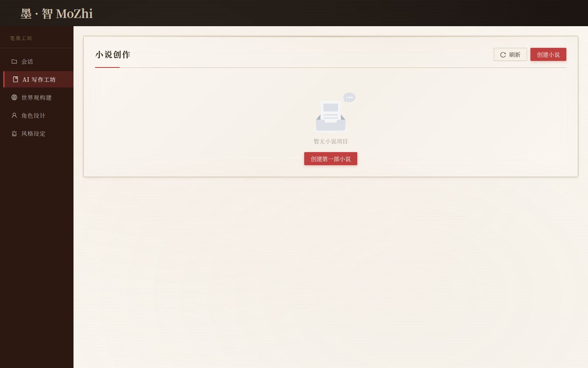
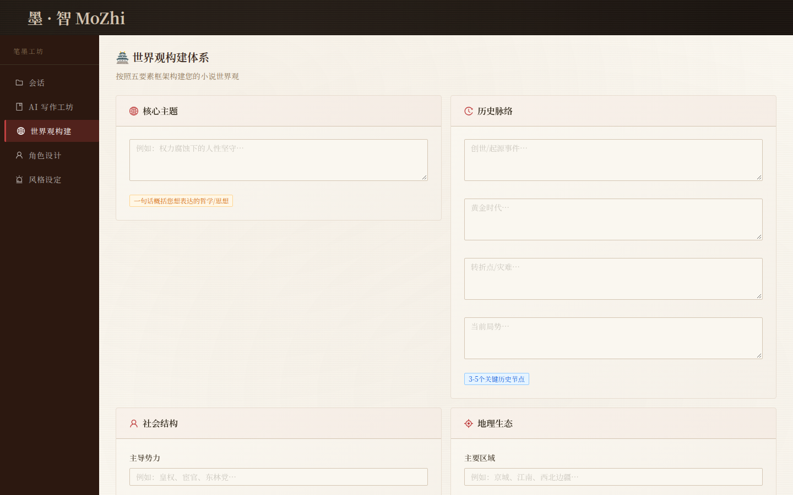
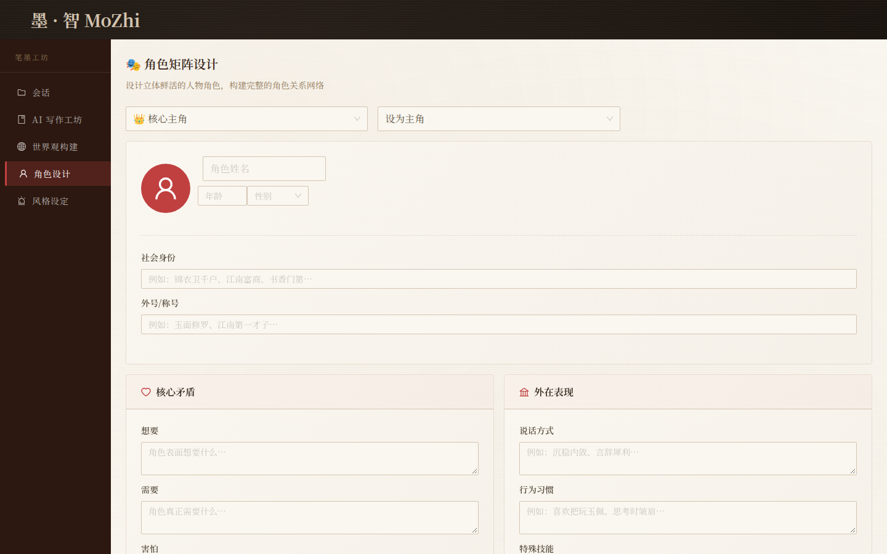
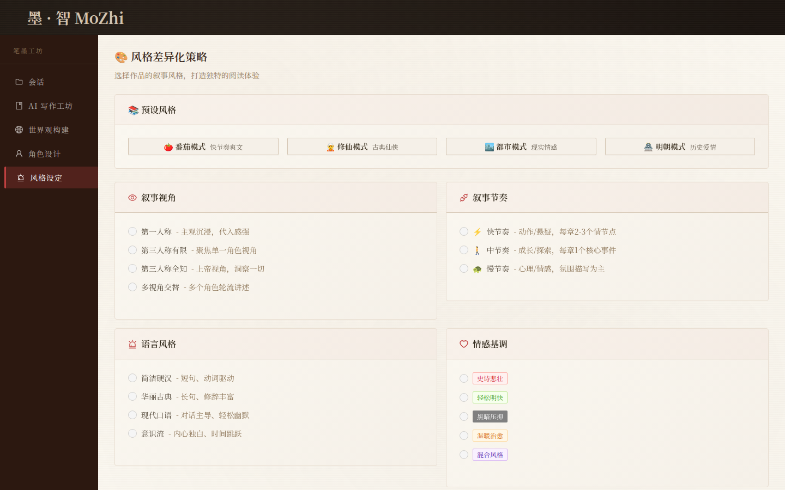

[English](README.md) | [中文](README.zh-CN.md)

# MoZhi (墨智)

Local-first workshop for drafting Chinese novels with a model you run yourself.

MoZhi is a single-user writing studio: a React workshop in the browser, and a FastAPI pipeline that asks [Ollama](https://ollama.com) for world notes, characters, style, and chapters. Projects stay in JSON files on disk. There is no hosted product, account system, or usage dashboard in this repository.

<p>
  
  
  
  
  
</p>

The Chinese write-up is kept as [README.zh-CN.md](README.zh-CN.md). This file is the overview to use. Figures in the Chinese file (seconds per chapter, accuracy, speedup) are design notes from that document. This repository does not include benchmark results.

## Features

What the current UI and API actually do:

- **Sessions and novels.** Create a writing session, then a novel with a theme and a style label (凡人流, 热血, 隐忍, 宏大, 番茄模式).
- **World, cast, and style.** Five-part world form, character cards (protagonist, mentor, rival, and others), and style axes for perspective, pace, diction, tone, and depth. Presets cover 番茄, 修仙, 都市, and 明朝.
- **Draft generation.** `POST /api/v1/ai/generate/worldview` and `.../character` call Ollama. Starting a draft runs `NovelWorkflow`: outline and chapter prompts, coherence and repetition checks, foreshadowing notes, a de-AI pass, generation gates, an editor loop, then plain-text export.
- **Length targets in config.** `short` 30,000 / `mid` 100,000 / `long` 300,000 / `tomato` 500,000 characters, or a custom target of at least 10,000. These are request settings, not measured output.
- **Progress.** Chapter list, word count, and a WebSocket at `/api/v1/ws/{novel_id}`.
- **Export.** Finished drafts are written as `.txt` under `novel_output/` (one file per chapter, plus a combined file). EPUB and PDF are not implemented.
- **Optional research.** Web search (DuckDuckGo via `ddgs`, with an HTML fallback), page fetch, and a small client for two named AI sites. See [Responsible use](#responsible-use).

The workshop shell loads without a model. Generation calls fail until Ollama is reachable.

## Stack

| Layer | Choice |
| --- | --- |
| UI | React 18, TypeScript, Vite 5, Ant Design 5, Zustand |
| API | FastAPI, Pydantic v2, Uvicorn |
| Model | Ollama HTTP API (`/api/generate`). Default model name is `llama2`; set `OLLAMA_MODEL` to whatever you have pulled. |
| Storage | JSON files in `./data` (`sessions.json`, `novels.json`). `DATABASE_URL` is declared and unused. |
| Research HTTP | `requests`, Beautiful Soup, `ddgs` |

`requirements.txt` caps FastAPI below 0.155. Version 0.155 removed `Query(enum=...)`, which `src/api/routes/network_routes.py` still uses. A newer FastAPI fails at import. The cap keeps that route as it is.

## Architecture

```
browser (frontend/, Vite :5173, proxies /api)
        |
        v
FastAPI  src/api/main.py  (:8000, prefix /api/v1)
  sessions · novels · writing · chat · ai/generate · network · ws
        |
        +-- FileSessionStore          ./data/*.json
        +-- NovelWorkflow             src/novel_agent/workflow.py
        |     prompts, coherence, foreshadowing, gates, editor loop
        |     PostProcessor, NovelExporter -> ./novel_output/*.txt
        +-- LLMClient                 Ollama at OLLAMA_BASE_URL
        +-- NetworkClient             outbound HTTP, private-address checks
              WebSearcher / WebFetcher / AISiteScraper / ProxyManager
```

```
src/
  api/            FastAPI app and routers
  core/           settings, logging, JSON session store, HTTP client, proxy list
  novel_agent/    drafting pipeline and research helpers
frontend/         React workshop (sessions, novel, world, characters, style)
tests/            unittest and pytest modules (see Tests)
```

Interactive API docs: `http://localhost:8000/docs` after the API is up.

## Quick start

You need Python 3.10+ (the image uses 3.11), Node.js 18+ for the UI, and [Ollama](https://ollama.com) for generation. A GPU is optional and is configured in Ollama, not in this repo.

### Docker Compose

Compose starts the API and the Vite dev server. It does **not** start Ollama. The API container expects Ollama on the host at `http://host.docker.internal:11434`.

```bash
git clone https://github.com/hjlangcore/MoZhi.git
cd MoZhi
docker compose up --build
```

- API: `http://localhost:8000` (`GET /health` reports whether it can reach Ollama)
- UI: `http://localhost:5173`

The frontend service runs `npm install` on each start, then `npm run dev -- --host`. The API image is `python:3.11-slim` and serves `uvicorn src.api.main:app`. Only `./logs` is mounted into the API container, so novels written inside that container are not on the host unless you add a volume.

`host.docker.internal` is provided by Docker Desktop. On Docker Engine for Linux, add it yourself or point `OLLAMA_BASE_URL` at a reachable host, for example:

```yaml
extra_hosts:
  - "host.docker.internal:host-gateway"
```

That snippet is not in `docker-compose.yml` today. Pull a model on the host before generating (`ollama pull qwen2.5:7b`, or any model you set as `OLLAMA_MODEL`).

### Local processes

```bash
git clone https://github.com/hjlangcore/MoZhi.git
cd MoZhi
python3 -m venv .venv
source .venv/bin/activate
pip install -r requirements.txt
cp .env.example .env
# set OLLAMA_MODEL to a model you have pulled

ollama serve
python run_api.py

# second terminal
cd frontend && npm install && npm run dev
```

Open `http://localhost:5173`. The UI creates a session named `默认写作会话` if none exists.

## Configuration

Copy `.env.example` to `.env`. Do not commit `.env` or a real `SECRET_KEY`. If `SECRET_KEY` is unset, the process generates an ephemeral key at startup. That key is not stable across restarts. Set one for any deployment you keep:

```bash
openssl rand -hex 32
```

Values below are the defaults in `src/core/config.py`.

### Read by the running process

| Variable | Default | Used for |
| --- | --- | --- |
| `APP_NAME` | `墨智 MoZhi` | API title and `GET /` |
| `APP_VERSION` | `0.1.0` | API version |
| `DEBUG` | `false` | Extra error detail for private-network clients only |
| `OLLAMA_BASE_URL` | `http://localhost:11434` | Ollama |
| `OLLAMA_MODEL` | `llama2` | Model name sent to Ollama |
| `OLLAMA_TIMEOUT` | `120` | Seconds for a generation request |
| `LOG_LEVEL` | `INFO` | Loguru level |
| `LOG_FORMAT` | loguru format string | Log line format |
| `CORS_ORIGINS` | localhost `3000` and `5173` | Browser origins |
| `CORS_ALLOW_CREDENTIALS` | `true` | CORS |
| `CORS_ALLOW_METHODS` | GET, POST, PUT, DELETE, OPTIONS | CORS |
| `CORS_ALLOW_HEADERS` | Authorization, Content-Type, and related | CORS |
| `API_PREFIX` | `/api/v1` | Router prefix |
| `SECRET_KEY` | random if unset | Loaded at startup. Not referenced by a login flow in this tree. |

`CORS_ORIGINS` is a JSON list, as in `.env.example`.

### Declared, not consulted by the current call path

These names are on `Settings` and in `.env.example`. Leaving them out does not change today's behavior.

| Variable | Default | Note |
| --- | --- | --- |
| `DATABASE_URL` | `sqlite:///./mozhi.db` | No SQLAlchemy session in the app. Novels are JSON under `./data`. |
| `LOG_ROTATION` | `100 MB` | The logger rotates at midnight and keeps 7 days in code. |
| `LOG_RETENTION` | `7 days` | Same. |
| `MAX_CHAPTER_WORDS` / `MIN_CHAPTER_WORDS` / `DEFAULT_CHAPTER_WORDS` | 5000 / 1000 / 2000 | Chapter length is taken from the writing request. |
| `SESSION_EXPIRE_HOURS` | `72` | Unused. |
| `NETWORK_TIMEOUT` / `NETWORK_MAX_RETRIES` / `NETWORK_REQUEST_INTERVAL` / `NETWORK_VERIFY_SSL` | 30 / 3 / 5 / true | `NetworkClient` uses its own constructor defaults. |
| `ENABLE_SSRF_PROTECTION` | `true` | `is_safe_url()` always runs before an outbound request. |
| `ALLOWED_URL_SCHEMES` | `http`, `https` | The client allows those two schemes in code. |
| `ALGORITHM` / `ACCESS_TOKEN_EXPIRE_MINUTES` | `HS256` / `30` | No token issuer in this tree. |
| `PROXY_ENABLED` / `PROXY_URL` | `false` / empty | A proxy is used only when a caller passes one. The network routes can set it. Default is off. |

Compose sets `DATABASE_URL` and `OLLAMA_BASE_URL` on the API service. The database URL still has no reader.

## Screenshots

Captured from this repo's Vite UI with the API running and no Ollama model loaded, so the panels are empty of generated prose. The interface is in Chinese.









## Responsible use

`src/core/network_client.py`, `src/core/proxy_manager.py`, `src/novel_agent/web_search.py`, `src/novel_agent/web_fetch.py`, and `src/novel_agent/ai_site_scraper.py` can request third-party sites and can send that traffic through a proxy you configure.

Use them only in ways the destination allows. Read the site's terms and `robots.txt`, identify the client honestly, and keep the request interval. A proxy is a path, not permission. Do not use it to hide access a site does not allow. The proxy list is empty until you add one. Nothing in this repository grants a right to scrape.

Outbound requests go through `is_safe_url()`, which rejects non-HTTP schemes and private, loopback, and link-local addresses.

## Tests

```bash
pip install -r requirements.txt pytest
pytest tests -q
```

| Module | Covers |
| --- | --- |
| `tests/test_utils.py` | Text helpers |
| `tests/test_duplicate_detector.py` | In-chapter and cross-chapter duplicate checks |
| `tests/test_continuity_checker.py` | Continuity checker against a sample novel state |
| `tests/test_security_fixes.py` | Secret is not the old hardcoded default, private-URL blocking, worldview input limits |

[`.github/workflows/tests.yml`](.github/workflows/tests.yml) runs that command on Python 3.11 for pushes and pull requests. There is no frontend test suite.

Earlier write-ups of security review and a test run are in [docs/](docs/):

- [docs/SECURITY_AND_PERFORMANCE_REPORT.md](docs/SECURITY_AND_PERFORMANCE_REPORT.md)
- [docs/SECURITY_FIXES_SUMMARY.md](docs/SECURITY_FIXES_SUMMARY.md)
- [docs/TEST_REPORT.md](docs/TEST_REPORT.md)

Those files are historical notes. They are not a current audit.

## Known gaps

Left as they are, so behavior stays the same:

- The style panel posts sample text to `/api/v1/style/analyze`. The route that exists is `POST /api/v1/ai/generate/style/analyze`.
- `GET /health` checks Ollama at `http://localhost:11434`, not `OLLAMA_BASE_URL`.
- Docker Compose does not ship Ollama, and Linux Engine does not define `host.docker.internal` unless you add it.

## License

[MIT](LICENSE). Copyright (c) 2026 hjlangcore (Haojie Wang).

## Author

Haojie Wang · [github.com/hjlangcore/MoZhi](https://github.com/hjlangcore/MoZhi) · [15303306269@163.com](mailto:15303306269@163.com)
